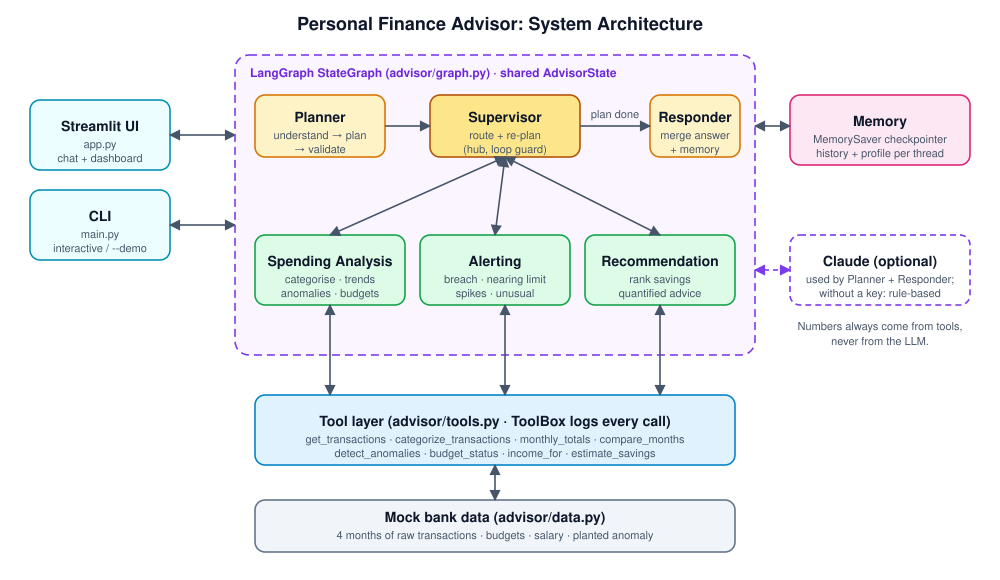
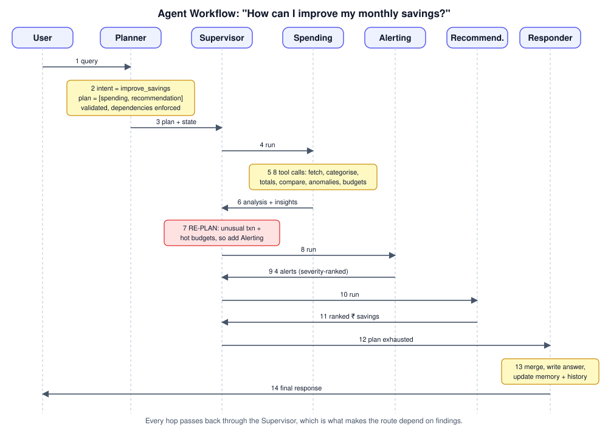

# Agentic AI Personal Finance Advisor (LangGraph)

A lightweight multi-agent system for a retail bank. It analyses a customer's (mock) transactions,
reasons across spending patterns, and returns insights, proactive alerts and personalised savings advice,
in a conversation that remembers context.

## Run

```bash
python3 -m venv .venv && .venv/bin/pip install -r requirements.txt
.venv/bin/python main.py --demo -v     # scripted multi-turn demo with the reasoning trace
.venv/bin/python main.py               # interactive chat
.venv/bin/streamlit run app.py         # web UI (chat + budget dashboard + reasoning trace)
.venv/bin/python -m pytest -q          # tests
.venv/bin/python main.py --graph       # print the LangGraph as Mermaid
```

Works **offline** with deterministic logic. Set `ANTHROPIC_API_KEY` and the Planner reasons with Claude
(structured output) and the Responder phrases the final answer with it (`ADVISOR_MODEL` to override).
If an LLM call fails, each node falls back to its deterministic path.

## Deliverables

| Deliverable | Where |
|---|---|
| Working prototype | `streamlit run app.py` (web UI) or `python main.py` (CLI) |
| Source code | `advisor/` (agents, tools, graph), `app.py`, `main.py`, `tests/` |
| Architecture explanation + diagram | below, and [docs/architecture.svg](docs/architecture.svg) |
| Agent workflow explanation + diagram | [docs/WORKFLOW.md](docs/WORKFLOW.md), [docs/workflow.svg](docs/workflow.svg) |
| Prototype demonstration | [docs/DEMO.md](docs/DEMO.md) (script) and [docs/demo_transcript.txt](docs/demo_transcript.txt) (real output) |

## Architecture



Hub-and-spoke: the Planner makes a plan, the **Supervisor** routes to one specialist at a time and takes every
result back, so it can re-plan. The Responder writes the answer and updates memory. Specialists only touch data
through the tool layer; the optional Claude LLM is used only for planning and phrasing.

## Agent workflow



Full step-by-step explanation, routing table and memory rules: [docs/WORKFLOW.md](docs/WORKFLOW.md).

### Components

| Module | Role |
|---|---|
| `advisor/agents/planner.py` | **In-depth agent.** Planner + Supervisor (below). |
| `advisor/agents/spending.py` | Runs a 8-step tool pipeline: fetch, categorise, month totals, like-for-like comparison, anomalies, budgets, insights. |
| `advisor/agents/recommendation.py` | Ranks discretionary categories by rupees saved; reduction target scales with stress. |
| `advisor/agents/alerting.py` | Budget breach / nearing limit / projected overspend / spikes / unusual transactions, with severity. |
| `advisor/agents/responder.py` | Merges outputs, writes the answer, updates memory. |
| `advisor/tools.py` | Typed pure functions behind a name-based `ToolBox` that logs every call. |
| `advisor/data.py` | Deterministic mock bank data (4 months, uncategorised, with a planted anomaly). |
| `advisor/graph.py` | LangGraph wiring: hub-and-spoke with a conditional router. |

## The in-depth agent: Planner / Supervisor

1. **Understand**: intent, month ("last month"), category focus, savings goal ("save 5000"). Follow-ups such as
   "what about food?" are resolved from memory.
2. **Plan**: choose specialists and order. Claude with a Pydantic schema, or rules.
3. **Validate**: the plan is never trusted. Unknown agents are dropped, dependencies are enforced
   (alerting and recommendation need spending first), order is canonicalised.
4. **Supervise**: after each specialist the supervisor re-reads the state and may **re-plan**. Example:
   the user asks for a spending breakdown, an unusual ₹6,999 transaction is found, so `alerting` is inserted.
   A step limit guards against loops.
5. **Hand off**: when the plan is exhausted, route to the Responder.

## Workflow example: "How can I improve my monthly savings?"

`planner` (intent = improve_savings, plan = spending, recommendation) → `supervisor` → `spending` (8 tool calls)
→ `supervisor` (finds unusual spend + hot budgets, **adds alerting**) → `alerting` → `supervisor`
→ `recommendation` (ranked ₹ savings) → `supervisor` → `respond`. Run with `-v` to see every hop.

## Design decisions

- **Hub-and-spoke over a fixed chain**: a supervisor lets the route depend on findings (conditional edges), which is the
  point of an agentic system rather than a pipeline.
- **Like-for-like comparison**: November (day 24) is compared with October days 1-24, so a partial month never looks like a drop.
- **LLM is optional, tools are not**: numbers always come from tools; the LLM only plans and phrases. The Responder is
  told to use only the facts bundle, so it cannot invent figures.
- **Memory**: LangGraph `MemorySaver` checkpointer keyed by `thread_id`; per-turn fields are reset by the planner,
  `memory` (focus category, goal, last intent/month) and `history` persist.
- **Swappable data layer**: only `tools.get_transactions` touches the mock data; a real banking API replaces one function.

## Limits

Mock data, in-memory persistence, rule-based categorisation by merchant keyword, straight-line month-end projection.
Advice is illustrative, not regulated financial advice.
