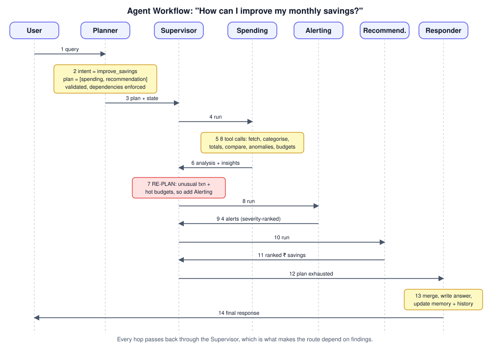

# Agent Workflow

The diagram shows one real run of **"How can I improve my monthly savings?"**
(reproduce it with `python main.py --demo -v`; the trace printed there matches these steps).

## Step by step

| # | Who | What happens |
|---|---|---|
| 1 | User | Sends a query through the web UI or CLI. |
| 2 | **Planner** | Parses intent, month, category focus and savings goal; resolves follow-ups from memory. Chooses specialists (`spending`, `recommendation`). The plan is validated: unknown agents dropped, dependencies enforced (recommendation and alerting need spending first), order made canonical. |
| 3 | Planner → Supervisor | Plan is stored in the shared `AdvisorState`. Per-turn fields are reset so nothing stale leaks from earlier turns. |
| 4-6 | **Spending Analysis** | Eight tool calls: fetch, categorise, this-month totals, same-days-last-month totals, compare, detect anomalies, budget status, income. Output: totals, % changes, unusual transactions, insights. |
| 7 | **Supervisor** | Re-reads the findings. An unusual ₹6,999 transaction and several budgets at 80%+ exist, so it **inserts `alerting`** into the plan, even though the user never asked for alerts. |
| 8-9 | **Alerting** | Produces severity-ranked alerts: critical (budget exceeded), warning (nearing limit, spike), info (unusual transaction). |
| 10-11 | **Recommendation** | Ranks discretionary categories by rupees saved; reduction target (10/15/20%) scales with how stressed the category is. |
| 12 | Supervisor | Plan exhausted (or the 8-step loop guard hit), so route to the Responder. |
| 13-14 | **Responder** | Merges all outputs into one answer, writes memory (focus category, goal, last intent/month) and conversation history, returns the reply. |

## Routing rules (Planner)

| Intent (example query) | Specialists planned |
|---|---|
| `improve_savings` ("How can I improve my monthly savings?") | spending → recommendation |
| `spending_summary` ("How much did I spend on travel?") | spending |
| `alerts` ("Am I overspending anywhere?") | spending → alerting |
| `category_deep_dive` ("Why is my food spending high?") | spending → recommendation (focused on that category) |
| `financial_health` ("How am I doing overall?") | spending → alerting → recommendation |
| `smalltalk` ("hello") | none: the Responder replies with help text |

The Supervisor can add `alerting` to any plan when the findings in scope warrant it
(for a category question, only findings in that category count).

## Memory and context

A LangGraph `MemorySaver` checkpointer is keyed by `thread_id`, so state survives between turns:

- `memory`: focus category, savings goal, last intent, last month. "And what about shopping?" reuses the
  goal set earlier; "what about food?" inherits the month.
- `history`: the conversation turns.
- A remembered month carries over only into explicit follow-ups ("what about", "and", "that"), never into a
  fresh question. Greetings never overwrite the remembered intent.

## Failure handling

- LLM unavailable, no key, or a bad structured output: the Planner falls back to its rules and logs why in the trace.
- Same for the Responder: it falls back to the deterministic template.
- Supervisor loop guard: after 8 hops it stops and responds with what it has.
